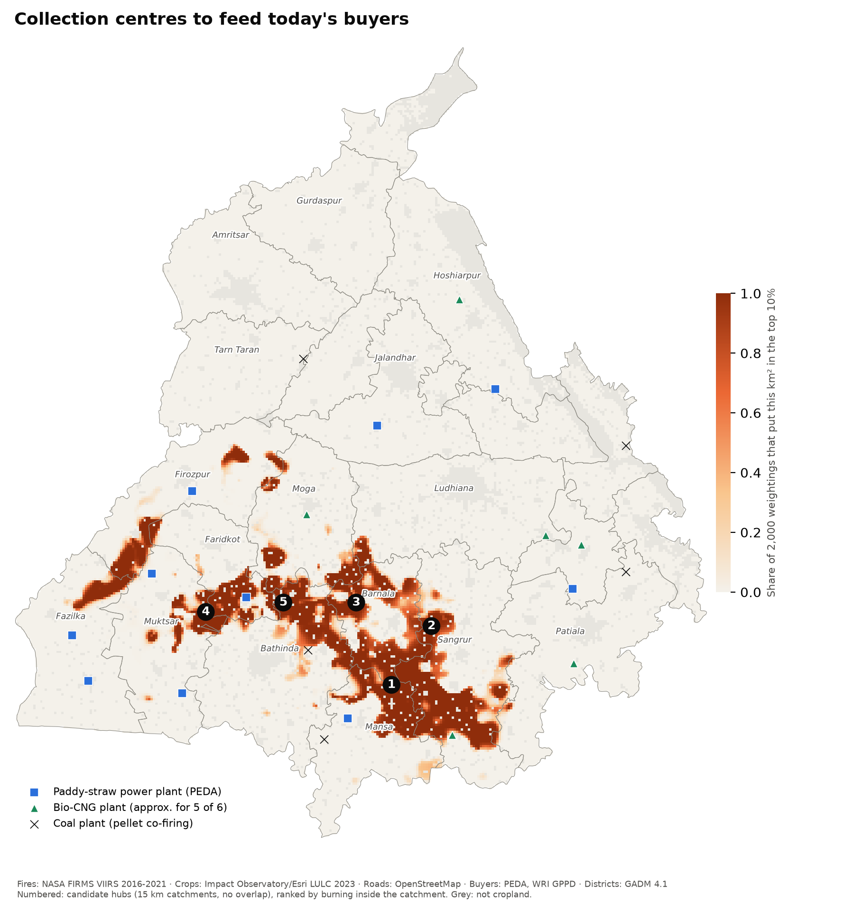

# Punjab crop-fire model

**Where should paddy-straw collection go in Punjab, India, so that farmers stop burning it?**

Every October and November, farmers in Punjab burn the stubble left after the rice harvest so they can sow wheat in time. The smoke is a major part of North India's winter air crisis. Paying farmers for straw only works if someone nearby will buy it. This project uses 25 years of NASA satellite fire data, a 10 m crop map, road networks and the state's list of straw buyers to show where collection hubs would do the most good, and how confident we can be in each answer.

It is open source from start to finish. All data are public, no API keys are needed, and every number below can be reproduced by running three scripts.



## What the model finds

| Finding | Number | Where it comes from |
|---|---|---|
| Burning happens in the same places year after year | Spearman ρ = **0.92** between 2016–21 and 2022–25 fire maps | `summary_v2.json` |
| The model predicts the future, not just the past | The top 10% of land, chosen using only 2016–21 fires, held about 20% of the held-out 2022–25 fires: **1.98×** what chance would give (scenario A) | held-out test, `summary_v2.json` |
| Satellite fire counts have fallen sharply | VIIRS 2025 = **6%** of the 2016–21 average | `archive_summary.json` |
| The south burns later than the north | South later in **14 of 14** seasons, by about **9 days** | `archive_summary.json` |
| Distance to a buyer is not the main gap | **85%** of eligible farmland lies within 50 km of a straw buyer, but listed straw power plants use only about **1.17 million t/yr** | `summary_v2.json` |
| Feed today's buyers (scenario A) | **9** robust hubs, **3,699 km²**; Mansa, Sangrur and Barnala lead | `zones_A.geojson` |
| Site a new buyer (scenario B) | **5** robust hubs; the Sangrur–Barnala belt is the largest gap | `zones_B.geojson` |

**A caution I keep in front of every number:** falling fire counts do not mean burning fell by the same amount. Since about 2022 more burning happens in the late afternoon, after the satellite has passed, so counts undercount it (Jethva 2026; Misra et al. 2026). That is why the model uses fire *patterns* (where), which stay stable, rather than fire *totals* (how much).

## How it works, in plain English

1. **Grid.** Punjab is split into 1 km squares (50,192 km²). A square is eligible if at least half of it is cropland and less than 30% is built up (Impact Observatory / Esri 10 m land cover, 2023).
2. **Burning.** Count VIIRS fire detections in each square for the 2016–21 seasons (October–November, vegetation fires only, low-confidence and same-day duplicates removed). Seasons 2022–25 are **held out** and used only to test the model.
3. **Market.** Measure the distance from each square to the nearest straw buyer: the 11 paddy-straw power plants and 6 operating bio-CNG plants listed by the Punjab Energy Development Agency (PEDA). Full score within 50 km, falling to zero at 100 km. In scenario B the score is reversed to find gaps, places with heavy burning and no buyer competing for straw.
4. **Roads.** Distance to the nearest motorway, trunk, primary, secondary or tertiary road (OpenStreetMap). Full score within 2 km, zero beyond 10 km.
5. **Supply.** Straw available within a 15 km collection radius: cropland × 75% paddy share × 4.81 t of baled straw per hectare (Bhullar et al. 2024).
6. **Combine.** Weighted sum: burning 40%, market 30%, roads 20%, supply 10%.
7. **Test the weights.** Nobody knows the "right" weights, so the model draws 2,000 random weight sets around these values (a Dirichlet distribution, following Ligmann-Zielinska et al. 2014). A square counts as **robust** only if it lands in the top 10% in at least 80% of the draws.
8. **Pick hubs.** Take the best robust square, block out its catchment so hubs do not overlap, and repeat. Report each hub with its fires, straw supply, nearest buyer and road distance.
9. **Check against the future.** Ask how much of the held-out 2022–25 burning falls inside the top 10% of squares. A lift above 1 means the model found the places that kept burning.

## Run it

```bash
pip install -r requirements.txt
python src/fetch_archive.py      # NASA FIRMS yearly archives (no key), clipped to Punjab and Haryana, about 140 MB
python src/season_archive.py     # 25 seasons: totals, district shares, north-to-south timing
python src/suitability_v2.py     # the suitability model, both scenarios, robustness and held-out test
```

Two inputs need a one-time manual download into `data/`:
- **GADM 4.1, India, level 2** (district boundaries) from [gadm.org](https://gadm.org/download_country.html). Put `gadm41_IND_2.shp` and its sidecar files in `data/`, or set `GADM_PATH`. GADM's licence does not allow redistribution, so it is not included here.
- **OpenStreetMap, India northern zone** from [Geofabrik](https://download.geofabrik.de/asia/india.html), saved as `data/northern-zone-latest.osm.pbf`.

The land-cover step reads from Microsoft Planetary Computer the first time. A cached copy (`outputs/model/landcover_frac.npz`, 176 KB) is included so the model runs without it. `src/build_buyers.py` rebuilds the buyer layer from PEDA's tables, with cached geocodes.

## Repository layout

```
src/        fetch_archive.py, season_archive.py, suitability_v2.py, build_buyers.py
data/       buyers.csv / buyers.geojson (straw buyers with locations and precision flags), geocode cache
outputs/    figures/ and tables/ (results as committed); model/ is regenerated on each run
```

## Limits

- Buyer locations: one bio-CNG plant has a village-level location; the other five sit at their town or district centre and are flagged `approx`.
- Coal plants buy pellets, not loose straw, so they appear only in a variant of scenario A (`scenario_A_with_coal`).
- The weights and distance thresholds are judgement calls. The robustness test shows which answers survive changing them, but it does not remove the judgement.
- This is a planning screen, not a business case. A hub still needs farmers, balers, storage and a buyer contract on the ground.

## How this was built

This began as an ArcGIS Pro model I built in May 2026 for a StoryMap on six Punjab districts. Here I rebuilt it for the whole state in open-source Python, with far more fire data, a held-out test and a robustness check. I designed the method, the questions and every rule in plain English. The code was written with an AI coding assistant (Claude Code) working from that specification, and I checked it by rerunning it and comparing the results with the earlier model and the literature. Writing the logic in plain language first, then making the code follow it, is how I work.

## Data and credits

- Fires: NASA FIRMS, VIIRS S-NPP 375 m (2012–2025) and MODIS 1 km (2001–2025) yearly archives. NASA open data.
- Land cover: Impact Observatory / Esri 10 m Land Use Land Cover 2023, via Microsoft Planetary Computer, CC BY 4.0.
- Roads: © OpenStreetMap contributors, ODbL.
- Buyers: Punjab Energy Development Agency (PEDA), biomass power and bio-CNG project tables (read 8 Nov 2026); WRI Global Power Plant Database; geocoding by OpenStreetMap Nominatim.
- Districts: GADM 4.1 (not redistributed).

Literature cited in the method: Ligmann-Zielinska et al. (2014) on weight uncertainty in suitability analysis; Bhullar et al. (2024) on straw yield; Jethva (2026) and Misra et al. (2026) on afternoon burning and satellite undercounts.

Code: MIT licence. Author: Jatin Rawtani.
